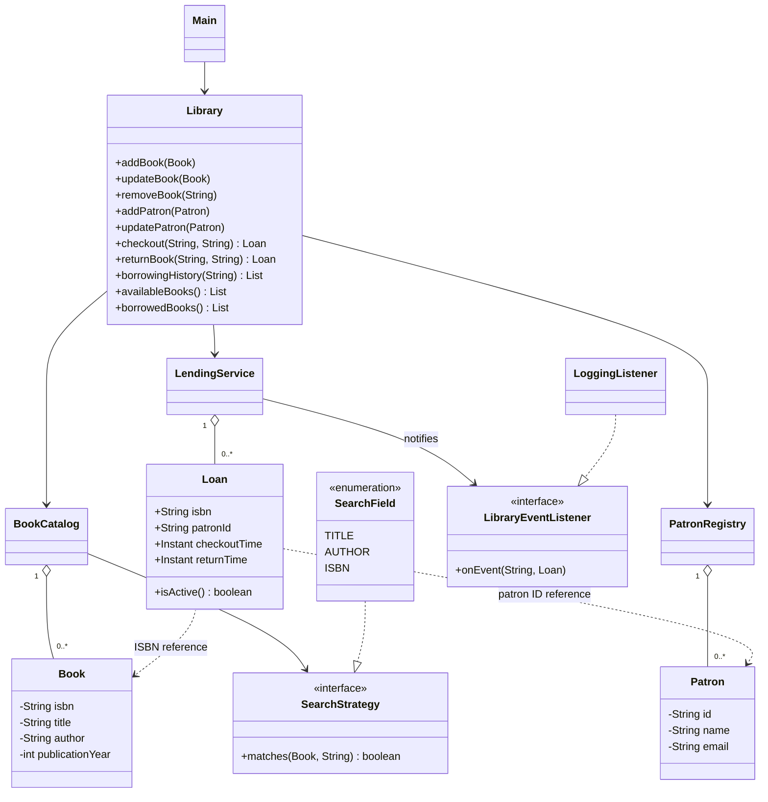

# Library Management System

A simple Java console application for librarians to manage books, patrons, and lending. Built with Core Java and in-memory collections to demonstrate OOP, SOLID and design patterns. No database, external API or dependencies are required.

## Features

- Add, remove and update books (title, author, ISBN, publication year).
- Search by title, author or ISBN; title and author support case-insensitive partial matches.
- Register and update patrons; view their active and completed borrowing history.
- Check out and return books; view available and borrowed inventory.
- Reject duplicate ISBNs, duplicate patron IDs, invalid loans, double checkout, wrong-patron returns and removal of borrowed books.
- Log important operations and errors using `java.util.logging`.

## Run locally

Requires JDK 21. Open a terminal in the project root and run:

```text
javac -d out -sourcepath src/main/java src/main/java/library/Main.java
java -cp out library.Main
```

The console menu lets you add a book, register a patron, check out the book, view inventory, return it and inspect history. For example, add a book with ISBN `9780132350884`, register patron `P1`, and use those identifiers for checkout and return.

## Tests

```text
javac -d out -sourcepath src/main/java src/test/java/library/LibraryTest.java
java -cp out library.LibraryTest
```

The dependency-free test runner checks book and patron management, all search fields, custom search strategies, lending, inventory, history, invalid operations and observer events. It throws an assertion error on failure.

## Class diagram



## Design principles

**OOP:** Book and Patron encapsulate private immutable fields. Loan is an immutable record. Interfaces define search and event contracts (abstraction); SearchField and LoggingListener implement these interfaces (interface inheritance and subtype polymorphism). The catalog can use any SearchStrategy, and lending can notify any LibraryEventListener. Composition is preferred over unnecessary class inheritance.

**SOLID:** Single Responsibility separates catalog, registry, lending, console and logging. Open/Closed allows new search strategies and listeners without modifying those services. Liskov Substitution requires implementations to honor their interface contracts. Interface Segregation keeps each interface focused on one operation. Dependency Inversion makes search and event dispatch depend on abstractions; Library receives its collaborators and LendingService receives its clock through constructors. Concrete in-memory stores are retained for simplicity.

**Design patterns:** Strategy (`SearchStrategy`, `SearchField`) switches search behavior. Observer (`LibraryEventListener`, `LoggingListener`, `LendingService`) publishes lending events to registered listeners without hard-coding logging into lending operations.

**Collections:** Maps index books by ISBN, patrons by ID and active loans by ISBN; lists store loan histories and observers. Lookup by ID is expected O(1); searches and inventory listings scan books in O(n).

## Scope and assumptions

One inventory item per ISBN, immutable ISBN and patron ID, a single library, single-threaded console use. Updates replace book or patron details without changing identity. Borrowing history retains ISBNs even after removal from inventory. All data is lost when the application exits. Multi-branch support, reservations and recommendations are optional assignment extensions and are intentionally excluded.
